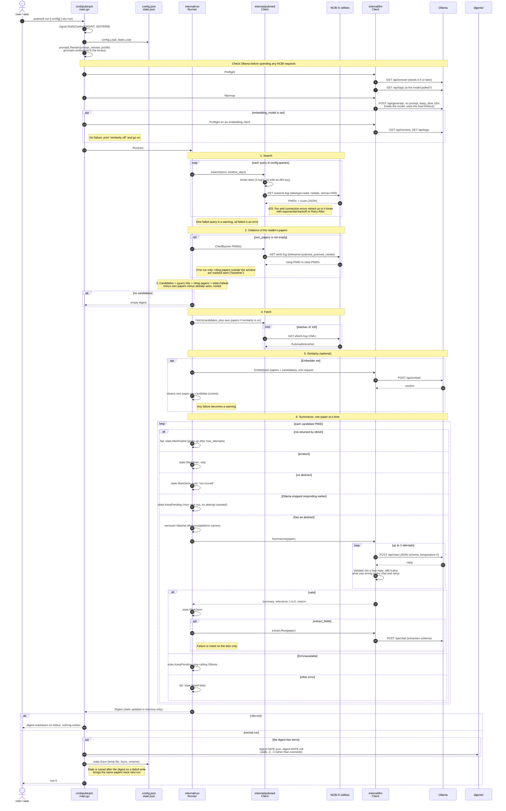
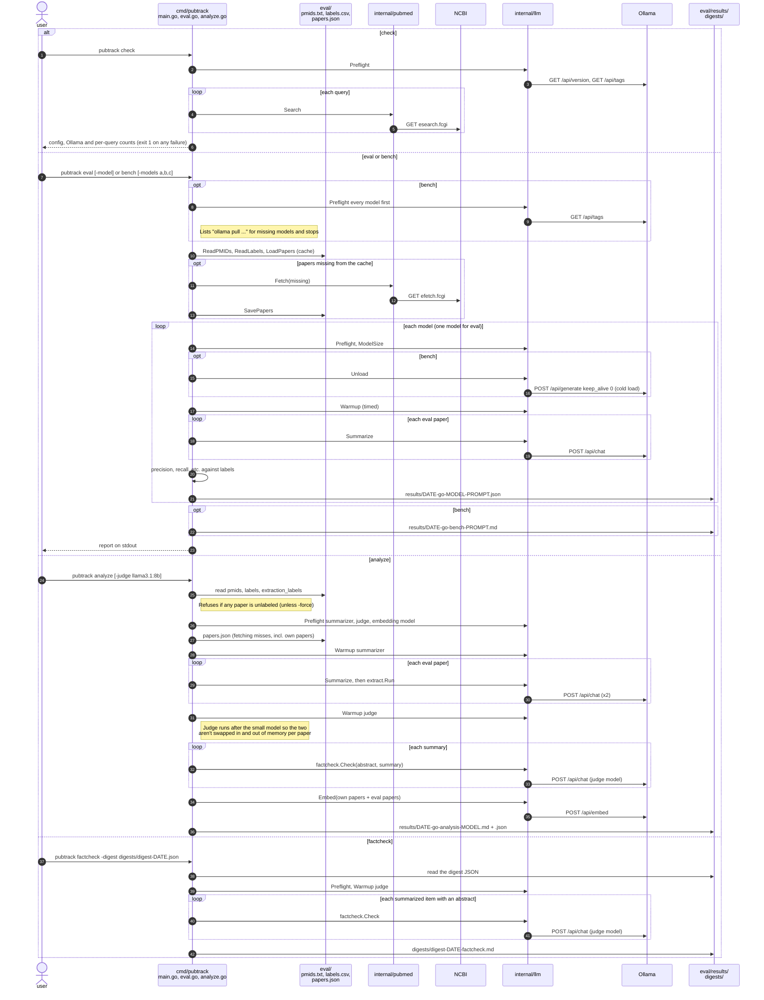

# pubtrack (Go): sequence diagrams

Two diagrams: `pubtrack run`, the weekly cron job, and the commands that check a setup or measure
the model (`check`, `eval`, `bench`, `analyze`, `factcheck`). Participant names are the Go packages
that do the work.

## `pubtrack run`

## `check`, `eval`, `bench`, `analyze`, `factcheck`

